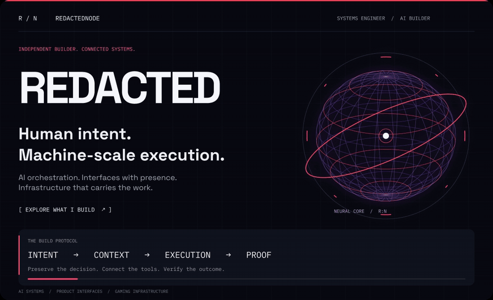
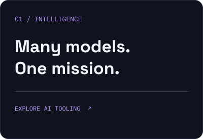
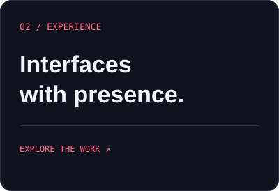
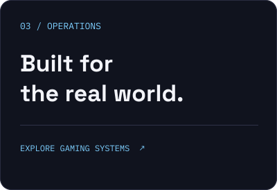

  <a href="https://github.com/RedactedNode?tab=repositories"><strong>ENTER THE WORKBENCH ↗</strong></a>
  &nbsp;&nbsp; · &nbsp;&nbsp;
  <a href="https://vicegamer.com"><strong>VICE NETWORK ↗</strong></a>
  &nbsp;&nbsp; · &nbsp;&nbsp;
  <a href="./assets/control-plane-poster.png">Static view</a>

 

### Intelligence is only useful when it becomes something you can use.

I'm **REDACTED**, a systems engineer connecting **AI orchestration, product interfaces, and gaming infrastructure**. My focus is the whole experience: how it looks, how it thinks, and how it holds up when people use it.

 

  
  
  

 

**One operating standard:** preserve context → connect the tools → execute → verify.

## What I build

| Area | Capabilities across my projects |
| --- | --- |
| **AI orchestration & project continuity** | Human approval gates, agent roles, structured shift handoffs, and local-first planning. I deploy OpenAI-compatible model gateways with provider routing, fallback, quota controls, and health checks. |
| **Knowledge & decision systems** | Git-backed knowledge ledgers, Obsidian workflows, architecture decision records, source provenance, and human-reviewed decisions. I build secret-redacted session archives with searchable indexes and integrity manifests, plus anonymized decision datasets for analysis. |
| **Web apps & product interfaces** | React, Next.js, TypeScript, Node.js, HTML, and CSS. Work includes responsive design systems, installable PWAs with camera input, owner dashboards, content approval, quote builders, scheduled jobs, SEO metadata, and optimized images and social previews. |
| **Backend, data & integrations** | Python, discord.py, PostgreSQL, SQLite, and SMTP. I build Discord slash commands, role-based permissions, persisted workflows, database migrations, and retryable background jobs. I also design multi-tenant architectures with scoped access, audit logs, adapter-based integrations, and queued processing. |
| **Game infrastructure & community operations** | Multi-instance Arma Reforger hosting with SteamCMD, Windows services, isolated profiles, PID-safe lifecycle scripts, and automated mod version, size, and dependency reports. My Discord tooling supports recruitment, rosters, tickets, and after-action reporting. Vice Network work includes FiveM resources and responsive in-game UI. |
| **Deployment & quality engineering** | Windows Server, PowerShell, NSSM, Docker packaging, Caddy reverse-proxy configuration, service health checks, and rollback documentation. I use Vitest, Playwright, and axe for unit, browser, and accessibility checks. |
| **Media automation** | Local gameplay ingest, media fingerprinting, FFmpeg/FFprobe workflows, resumable Faster-Whisper transcription, SRT/WebVTT captions, highlight scoring, review and approval, and captioned vertical and horizontal exports. |

<strong>Open the field notes ↗</strong>

 

- **AI systems:** provider-agnostic workflows, project continuity, structured handoffs, and automation.
- **Interfaces:** clear hierarchy, purposeful motion, and tools that make complex work easier to navigate.
- **Operations:** deployment, databases, Discord integrations, Arma Reforger, and FiveM.
- **Open-source exploration:** my public workbench includes forks; original authors retain credit for their projects.

 

  <strong>HUMAN-LED. AI-AMPLIFIED. OUTCOME-DRIVEN.</strong>

