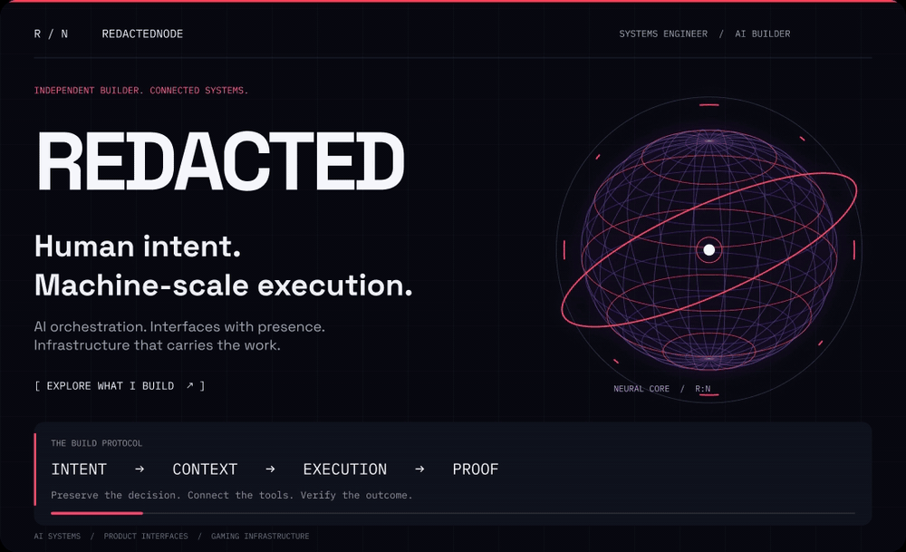
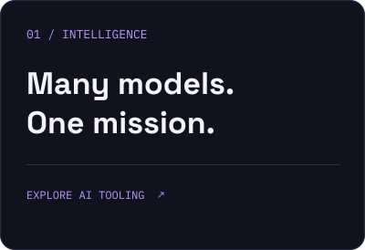
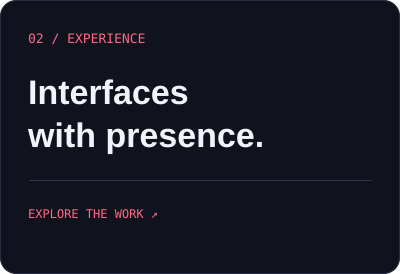
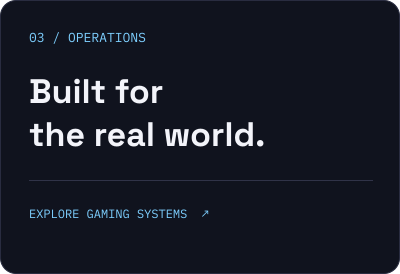

  <a href="https://github.com/RedactedNode?tab=repositories"><strong>ENTER THE WORKBENCH ↗</strong></a>
  &nbsp;&nbsp; · &nbsp;&nbsp;
  <a href="https://vicegamer.com"><strong>VICE NETWORK ↗</strong></a>
  &nbsp;&nbsp; · &nbsp;&nbsp;
  <a href="./assets/control-plane-poster.png">Static view</a>

 

### Intelligence is only useful when it becomes something you can use.

I'm **REDACTED**, a systems engineer connecting **AI orchestration, product interfaces, and gaming infrastructure**. My focus is the whole experience: how it looks, how it thinks, and how it holds up when people use it.

 

  
  
  

 

**One operating standard:** preserve context → connect the tools → execute → verify.

<strong>Open the field notes ↗</strong>

 

- **AI systems:** provider-agnostic workflows, project continuity, structured handoffs, and automation.
- **Interfaces:** clear hierarchy, purposeful motion, and tools that make complex work easier to navigate.
- **Operations:** deployment, databases, Discord integrations, Arma Reforger, and FiveM.
- **Open-source exploration:** my public workbench includes forks; original authors retain credit for their projects.

 

  <strong>HUMAN-LED. AI-AMPLIFIED. OUTCOME-DRIVEN.</strong>

