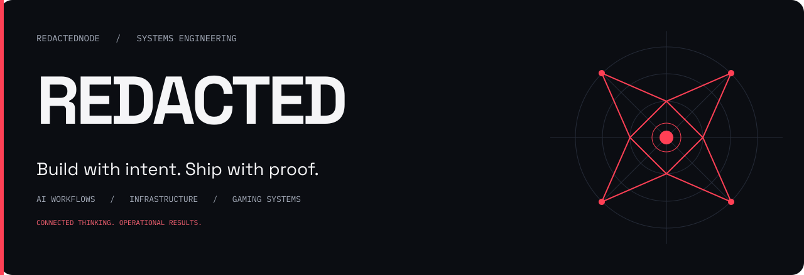

  

  <a href="https://github.com/RedactedNode?tab=repositories"><strong>EXPLORE THE WORK ↗</strong></a>
  &nbsp;&nbsp; / &nbsp;&nbsp;
  <a href="https://vicegamer.com"><strong>VICE NETWORK ↗</strong></a>

 

### Systems that turn ideas into operations.

I'm **REDACTED**, a systems engineer working across AI workflows, application infrastructure, and multiplayer communities. I care about how the pieces connect: the interface, the automation, the deployment, and the person using it.

**Current focus:** making AI-assisted work easier to coordinate, preserve, and carry through to completion.

 

<table>
<tr>
<td width="33%" valign="top">

**01 / INTELLIGENCE**

### AI & workflows

Provider-agnostic tooling, project continuity, structured handoffs, and automation with verifiable outcomes.

</td>
<td width="33%" valign="top">

**02 / INFRASTRUCTURE**

### Build & operate

Application deployment, databases, service orchestration, and the systems that keep products running.

</td>
<td width="33%" valign="top">

**03 / INTERACTIVE**

### Gaming & community

Arma Reforger, FiveM, Discord integrations, and the operational tooling behind multiplayer experiences.

</td>
</tr>
</table>

 

### The operating principles

**Keep context.** Decisions should survive the handoff.  
**Reduce friction.** Use the simplest system that gets the job done.  
**Prove the result.** Finish, test, repair, verify.

 

### Open-source workbench

A selection of upstream projects I explore through forks. **Credit belongs to their original authors.**

| Area | Explore |
| :--- | :--- |
| Mission tooling | [TilW Mission Framework](https://github.com/RedactedNode/tilw-mission-framework) |
| Game Master tooling | [GME_AR](https://github.com/RedactedNode/GME_AR) |
| Community integrations | [Arma Discord bot](https://github.com/RedactedNode/arma-bot-5th-SFG-pve) |

 

---

  <strong>REDACTEDNODE</strong> &nbsp; / &nbsp; CONNECTED THINKING. OPERATIONAL RESULTS.

